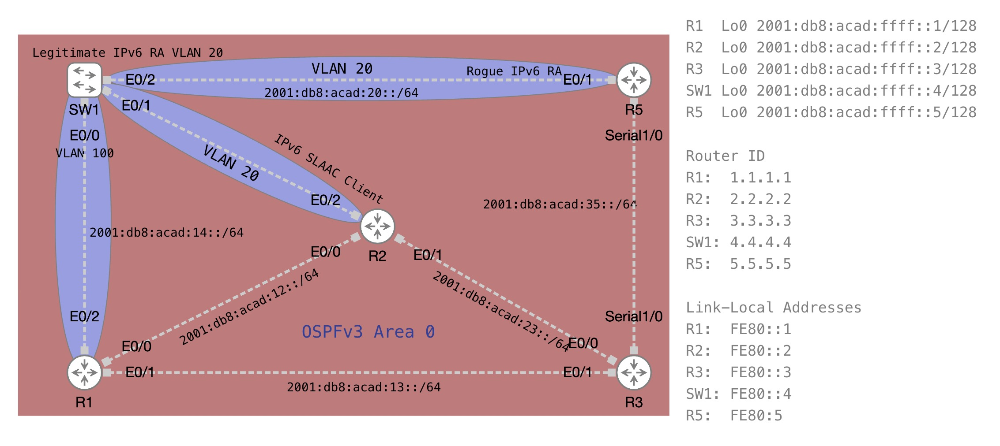

# OSPFv3 Unlocked: Routing the IPv6 Way

*Abstract:* The CCNA v2.0 blueprint puts a fresh spotlight on IPv6 dynamic routing and modern first-hop security. In this lab we break down everything you need to know about OSPFv3.
We’ll explore how OSPFv3 builds upon familiar OSPFv2 concepts while tackling key IPv6 differences, including link-local next hops, 32-bit router ID configuration, and per-interface network configuration across broadcast and point-to-point links. Along the way, we’ll dive into first-hop defense with IPv6 RA Guard to protect clients from rogue router advertisements.

