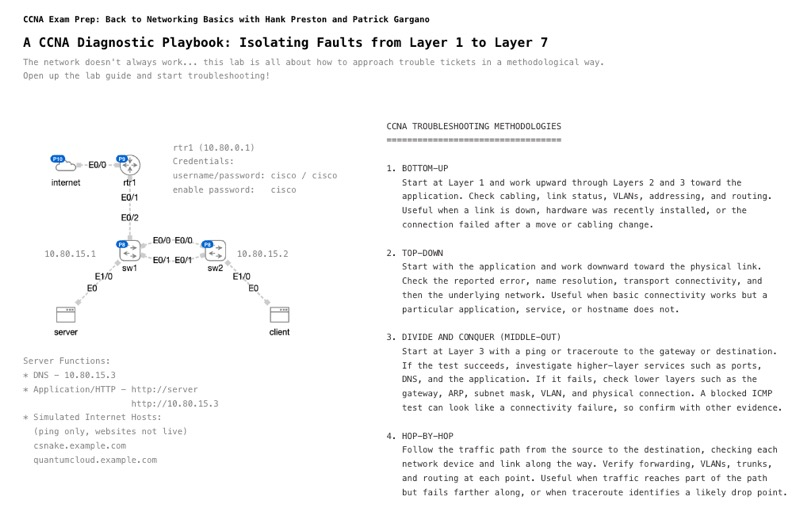

# CCNA Prep 2026 S4E2 - Isolating Faults from Layer 1 to Layer 7 

*Abstract:* When network connectivity breaks, where do you begin? Troubleshooting is a cornerstone of the CCNA v2.0 exam, and having a systematic diagnostic methodology is what separates guessing from true engineering. In this live stream, Hank and Patrick build a practical diagnostic playbook from the ground up. We'll explore structured troubleshooting models using the OSI stack, highlighting core diagnostic tools including show commands, syslog inspection, standard/extended ping, and traceroute. We’ll also analyze pre-staged packet capture output to interpret real-world protocol behaviors (ARP, DHCP, and 802.1Q tags) without getting bogged down in capture setup. Finally, we'll configure and verify Layer 2 storm control to protect access switches from broadcast storms. Join us to sharpen your troubleshooting instincts! 

