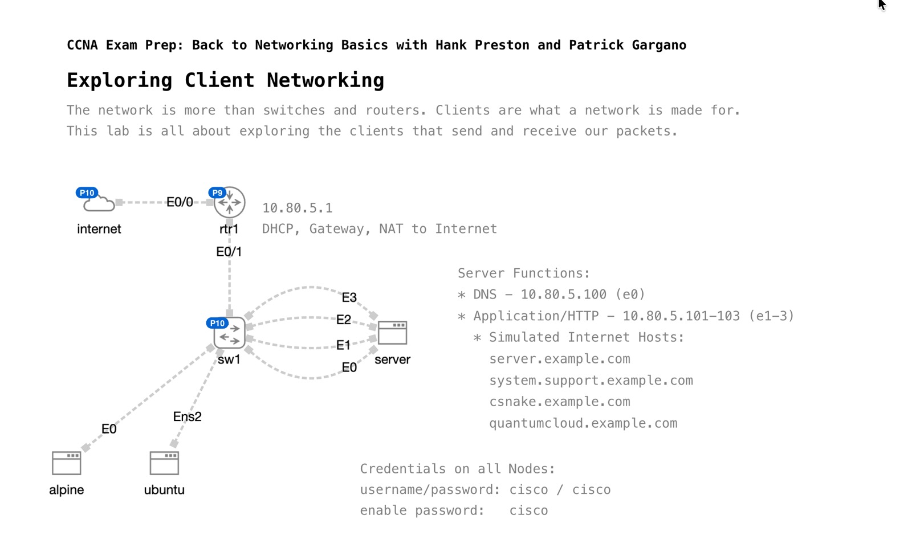

# CCNA Prep 2026 S4E3 - Exploring Client Networking on Windows, Mac, and Linux 

*Abstract:* Troubleshooting the network doesn’t start at the default gateway—it starts directly on the client. The CCNA v2.0 blueprint explicitly requires engineers to gather, interpret, and troubleshoot network parameters across Windows, macOS, and Linux endpoints. In this live event, Hank and Patrick demonstrate how to navigate the command-line and GUI diagnostic utilities of all three major operating systems. We'll examine static versus DHCP IPv4/IPv6 assignments, default gateway reachability, DNS resolver behavior, and wireless client metrics including SSID association, WPA2/WPA3 security negotiations, and signal-to-noise ratio (SNR). Join us to master the endpoint view of network connectivity!

