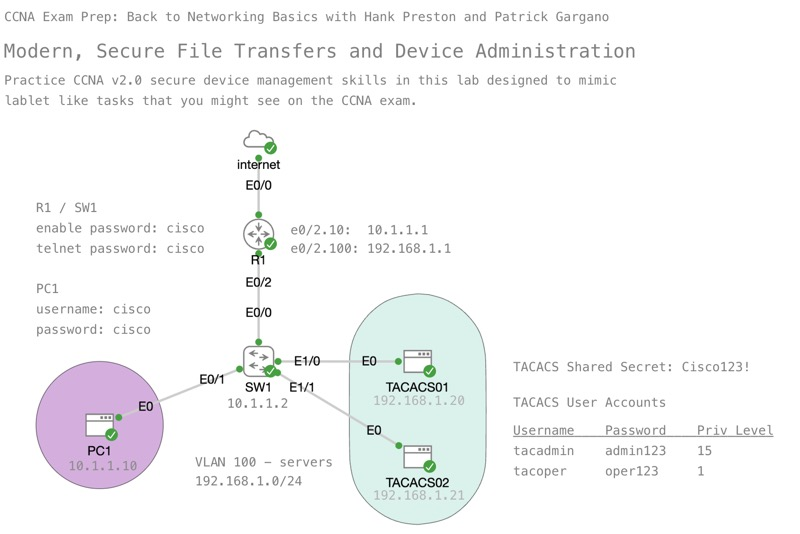

# CCNA Prep 2026 S4E3 - Modern, Secure File Transfers and Device Administration

*Abstract:* Unencrypted protocols like TFTP and Telnet belong in the past. The CCNA v2.0 blueprint highlights modern, secure device management as an essential operational skill for network engineers. In this episode, Hank and Patrick walk through the practical implementation of Secure Copy Protocol (SCP) and Secure File Transfer Protocol (SFTP) on Cisco IOS XE. We will focus on the exact CCNA scope: enabling the services on the device, setting up local administrative authentication, and executing secure file transfer operations for startup/running configurations and software images. Join us to make secure file transfer an effortless part of your day-to-day administration toolkit!

